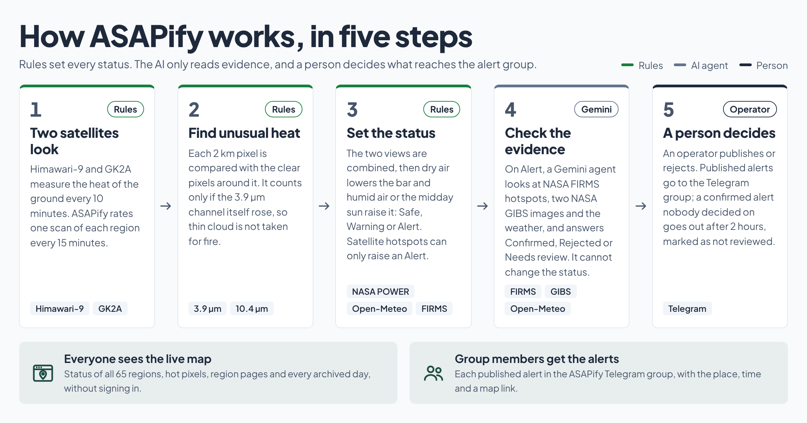

# ktp-asapify-fe

> **Frozen on 18 October 2026.** Development has stopped; this repository and its docs describe the app as it
> stands. Only fixes that keep the deployed site running belong here. The tag `freeze-2026-10-18` marks the final
> state of `main`; `freeze-2026-10-16` marks the state submitted on 16 October.

**GCP integration:** see [docs/GCP.md](docs/GCP.md) for Firebase Hosting, Google sign-in,
the operator custom claim and the Cloud Run API; the app sends the Firebase token.

ASAPify web app (Google Cloud AI Builder Cup 2026). **Public, no sign-in:** a map of 65 peat regions that the
backend's risk engine rates every 15 minutes from Himawari-9 and GK2A (SAFE < WARNING < ALERT, plus NO_OBSERVABLE),
with each slot's hot pixels and the VIIRS detections beside them (hover or tap one to read its value), a day player
that opens any archived day, read-only
region pages (ΔT, humidity and cloud timeline, how dry air and the sun moved ΔT, Fuzzy MAUT utilities, status
changes, the Gemini AI Analysis with the NASA GIBS images it looked at and the weather at the hot pixel), the Get
alerts page for the Telegram group, and About, whose diagrams tie each step to the data it reads and to where it
runs on Google Cloud. **Operators** (Google sign-in with the `role=operator` claim) also run
the Gemini AI Analysis (Re-verify), publish or reject each verification, and manage Telegram groups and operator
access on the Admin page. During the hackathon judging, a signed-in account can make itself an operator after a
CAPTCHA, without the Admin page (docs/GCP.md).

- Design: [docs/MOBILE_FIRST.md](docs/MOBILE_FIRST.md) (mobile-first rules and the brand manual's visual language)
- Engine and rules: `docs/ENGINE.md` in the backend repository, and the in-app About page
- Briefing site: `../asapify/` (`ui.html` screens, `backend.html` API, `cloud.html`, `runbook.html`); the contract
  tab stays the reference for the API
- The interface, code and API are English only.

## How it works



Every 15 minutes the backend rates 65 peat regions from Himawari-9 and GK2A, and rules alone set Safe, Warning or
Alert. On Alert a Gemini agent reads NASA FIRMS hotspots, two NASA GIBS images and the weather for the operator; it
cannot change a status. The operator publishes or rejects, and published alerts go to the ASAPify Telegram group. A
confirmed alert nobody decides on within 2 hours goes out by itself, marked as not reviewed. This app shows all of
it: the map and region pages to everyone, the decisions to operators.

## On Google Cloud


This repository is the web app on the left of that drawing. Firebase Hosting serves it and sends `/api/**` to the
Cloud Run service `asapify-api` on the same domain, and Firebase Authentication signs operators in with Google.
Everything from Cloud Run rightwards lives in the backend repository (`KRL-TEAM-PROJECT/ktp-asapify-be`).


## Inside the web app


| Screen | Path | Who | What it is for |
|---|---|---|---|
| Regions | `/` | Everyone | The map of 65 regions by status, hot pixels and VIIRS (hover or tap one), the region list and the day player |
| Region page | `/regions/:id` | Everyone | ΔT, humidity and cloud over time, the dry-air and sun shifts, Fuzzy MAUT, status changes, the Gemini AI Analysis; operators also run it again, publish or reject |
| Get alerts | `/join` | Everyone | Join the ASAPify Telegram group, with the links the backend returns |
| About | `/about` | Everyone | How it works, where it runs, statuses, rules, limits and data sources, with links between them |
| Admin | `/admin` | Admin | Link Telegram groups and their invite links; add or remove operators |
| API contract | `/api-contract` | Operators | Every endpoint, schema and error code, with examples |
| Login | `/login` | Operators | Google sign-in; during the judging period a CAPTCHA makes a signed-in account an operator |

All diagrams come from one slide deck, [docs/diagrams/asapify-diagrams.html](docs/diagrams/asapify-diagrams.html).
Download it and open it in a browser; arrow keys move between its 28 slides, and `?export=1` gives the light view
without controls that the images above were taken from. The backend README carries the same deck and the backend's
own diagrams.

## Running

```bash
npm install
npm run dev        # http://localhost:5173; /api is proxied to an asapify-api on :8080
npm run build      # tsc --noEmit + vite build → dist/
```

Needs Node ≥ 22.12 (`engines`). Copy `.env.example` to `.env.local` and fill it:

| Variable | Value | Meaning |
|---|---|---|
| `VITE_API_BASE` | URL | API base; empty = same origin (`/api` is proxied to `:8080` in dev) |
| `VITE_FIREBASE_*` | Firebase Web App config | Google sign-in for operators; see [docs/GCP.md](docs/GCP.md) |

## Deploy


The judged prototype runs on Firebase Hosting at https://hack2skill-510921.web.app,
deployed by the GitHub Actions workflow described in [docs/GCP.md](docs/GCP.md). A merge that changes only Markdown
or `docs/` does not deploy.

## API contract for the BE team

Open the **API contract** tab in the app (`/api-contract`, operators only). It lists conventions (auth, UTC time,
coordinates, errors), the error code table, every `asapify-api` endpoint (parameters, body, responses,
errors, the UI screens that use it), schemas, the static map files, and the internal endpoints.
JSON examples are static samples in `src/contract/spec.ts`.

## Data sources

Everything on the map and the region pages comes from these public sources, processed by the backend
(`KRL-TEAM-PROJECT/ktp-asapify-be`, `docs/ENGINE.md`):

| Data | What it shows in the app | Link |
|---|---|---|
| Himawari-9 (JMA), bands 7 and 13, NOAA Open Data on AWS | Hot pixels (cyan squares), ΔT, cloud | [registry](https://registry.opendata.aws/noaa-himawari/) |
| GEO-KOMPSAT-2A (KMA), SW038 and IR105, NOAA Open Data on AWS | Hot pixels (white square rings), ΔT, cloud | [registry](https://registry.opendata.aws/noaa-gk2a-pds/) |
| NASA FIRMS, VIIRS NOAA-20 / NOAA-21 | VIIRS detections (dark dots in a white ring), the Gemini AI Analysis hotspots | [FIRMS](https://firms.modaps.eosdis.nasa.gov/) |
| NASA GIBS, VIIRS NOAA-20 corrected reflectance | The two satellite images in the Gemini AI Analysis | [GIBS API docs](https://nasa-gibs.github.io/gibs-api-docs/) · [Worldview](https://worldview.earthdata.nasa.gov/) |
| NASA POWER, hourly skin temperature and humidity | The dry-air shift and POWER support | [POWER](https://power.larc.nasa.gov/) |
| Open-Meteo (CC BY 4.0) | Humidity (RH) and the weather at the hot pixel | [open-meteo.com](https://open-meteo.com/) |
| KHG peat hydrological units (KLHK) | The peat inside each of the 65 regions | [shapefile in the backend repository](https://github.com/KRL-TEAM-PROJECT/ktp-asapify-be/tree/main/tools/khg) |
| geoBoundaries IDN ADM1 (ODbL) | Province boundaries | [geoboundaries.org](https://www.geoboundaries.org/) |
| OpenFreeMap / OpenStreetMap | Basemap | [openfreemap.org](https://openfreemap.org/) · [© OpenStreetMap contributors](https://www.openstreetmap.org/copyright) |
| Gemini on Gemini Enterprise Agent Platform (formerly Vertex AI), Agent Development Kit | The Gemini AI Analysis | [Agent Platform](https://docs.cloud.google.com/gemini-enterprise-agent-platform/) · [ADK](https://google.github.io/adk-docs/) |
| Telegram | The alert group behind Get alerts | [Bot API](https://core.telegram.org/bots/api) |

## Light map

- MapLibre and the map page (±295 KB gzip) load only on the map route; every page needs ±123 KB gzip first (±17 KB of it is the motion core, see *Motion*), measured on the build of 18 October 2026. The region detail page also loads per route.
- Lite mode switches on automatically with data saver, RAM ≤ 2 GB, ≤ 2 cores (or ≤ 4 cores with RAM ≤ 4 GB),
  or reduced motion: plain basemap, no camera animation, pixel ratio 1, and interface transform
  motion off (fades only). A choice saved earlier on the device (`asapify.lite`) overrides the detection.
- Province boundaries: geoBoundaries IDN ADM1 (ODbL, © OpenStreetMap contributors), 15 provinces simplified to
  ±90 KB in `public/provinces.geojson`.
- Map labels (province names, OpenFreeMap basemap labels, MapLibre buttons) are English.

The data source is `src/contract/spec.ts` (TypeScript types stay in `src/types.ts`). The briefing's `backend.html`
summarises this contract; where they differ, the contract tab is the reference.

## Motion

Animation uses [`motion`](https://motion.dev) (the successor of framer-motion). Every component uses `m` from `src/motion`
(not `motion`), wrapped in `LazyMotion` inside `MotionProvider`: the ±17 KB gzip core ships in the initial bundle, the full
motion features (animation, gestures, layout, drag; ±20 KB gzip) load later as the `features` chunk. If that chunk fails
to load, `<html>` gets the `no-motion` class and the page shows without motion.

| Where | Motion |
|---|---|
| Page changes, cards, bars, charts | spring in when visible (`reveal`, `whileInView`); chart lines draw, bars grow |
| Navigation links | the active background slides between items (`layoutId`) |
| Dropdowns (`Select`) | the list opens from the button side, the option highlight slides with arrows/pointer |
| Region list | changing order/filter → cards slide into place; new cards stagger in, removed ones shrink away |
| Bottom sheet (screens < 1024 px) | dragged by its handle (`Sheet`): slow release → nearest position, flick → its direction; content still scrolls |
| Decision panel | reason/confirmation/error blocks fade in and out, elements below slide |
| Buttons, chips, switches, `<details>` | pure CSS: presses bounce (`--ease-spring`), switch knobs, `<details>` opens with a flowing height |

The system *reduced motion* preference and lite mode use `MotionConfig reducedMotion`: transform/layout motion jumps
to its end value; only opacity still fades. Spring presets live in `src/motion/presets.ts`.

## Technical notes

- MapLibre 6 loads its module worker from a separate file. The `maplibreWorker` plugin in `vite.config.ts`
  serves `maplibre-gl-worker.mjs` + `maplibre-gl-shared.mjs` as-is under `/maplibre/`
  (dev) and copies them to `dist/maplibre/` (build); `setWorkerUrl` points there.
- Basemap: OpenFreeMap `positron` (light) / `dark` (dark), no API key; a theme change calls `setStyle`
  and every data layer is reinstalled on `style.load`.
- Plus Jakarta Sans and JetBrains Mono are bundled through `@fontsource` (no Google Fonts).
