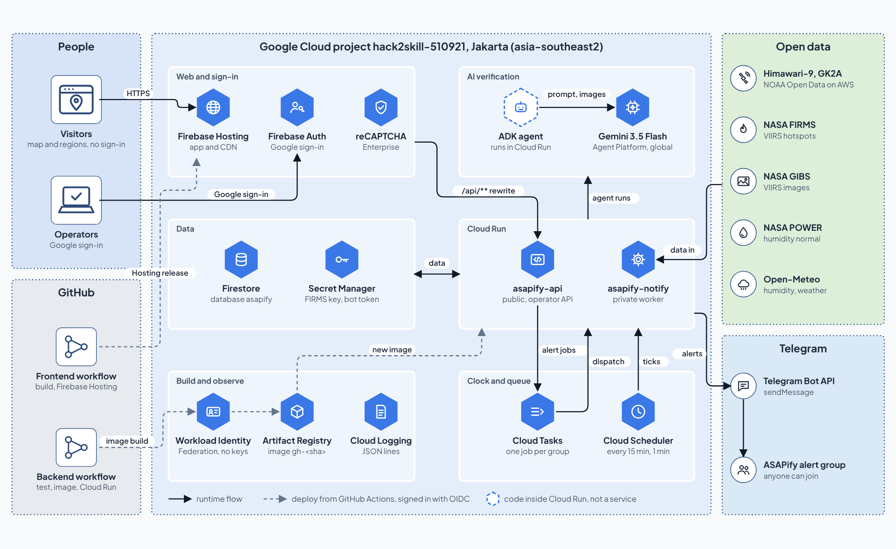

# Firebase Hosting + Google sign-in

The app sends Firebase tokens to the Cloud Run API.
Status at the freeze, 18 October 2026: live at https://hack2skill-510921.web.app (project `hack2skill-510921`).
Routine deploys go through GitHub Actions, not a laptop; see "Deploy" below. Manual steps 1–5
are only for a new project.



The whole Google Cloud setup in one drawing (from [diagrams/asapify-diagrams.html](diagrams/asapify-diagrams.html)).
This repository owns Firebase Hosting, the Firebase Web App and the frontend deploy; everything behind
`asapify-api` is set up from the backend repository.

1. Follow the backend setup in `ktp-asapify-be/docs/GCP.md`. The Firebase project id must match the backend.
2. Create a Firebase Web App, enable the Google provider and Authorized domains, then fill `.env.local`:

```dotenv
VITE_API_BASE=
VITE_FIREBASE_API_KEY=COPY_FROM_FIREBASE_WEB_APP
VITE_FIREBASE_AUTH_DOMAIN=COPY_FROM_FIREBASE_WEB_APP
VITE_FIREBASE_PROJECT_ID=SAME_PROJECT_ID
VITE_FIREBASE_APP_ID=COPY_FROM_FIREBASE_WEB_APP
```

The bundled province boundary file `public/provinces.geojson` comes from geoBoundaries; it holds boundary
geometry, not detection points. Check the attribution before publishing.

3. Install dependencies from the lockfile and build:

```bash
npm ci
npm run build
```

4. Run the official Firebase CLI with an authorised account, then deploy to an explicit project:

```bash
npx firebase-tools login
npx firebase-tools deploy --only hosting --project "$ASAPIFY_PROJECT_ID"
```

`firebase.json` rewrites `/api/**` to `asapify-api` in Jakarta before the SPA fallback.
Make sure Cloud Run accepts public invokers at the transport layer and that **the API verifies the
Firebase ID token on every `/operator/**`**. A Firebase token does not replace Cloud Run IAM;
without public transport, Hosting gets a 403 before the request reaches the app.

5. The first sign-in creates the Firebase user, but app access is only granted after an admin
adds the custom claim `role=operator`. The admin checks the UID/email, then uses `tools/set_operator.py`
from the BE repository; the user signs out and in again. No team email is allowed automatically.

6. **Hackathon judging only:** while the backend has `OPERATOR_SIGNUP_UNTIL` and `RECAPTCHA_SITE_KEY` (BE
`gcp/signup-setup.sh`), a signed-in account that is not an operator stays on the sign-in page and sees a reCAPTCHA
Enterprise checkbox (`src/components/OperatorSignup.tsx`). Solving it sends the request by itself; the account
becomes an operator until that day, without the Admin tab. The page loads `www.google.com/recaptcha/enterprise.js`
only then. Nothing to set in the FE: the site key comes from `GET /api/v1/access/signup`.

## Checks

- While the Firebase session restores, the page waits instead of rushing to the login page.
- Operator requests send `Authorization: Bearer <ID token>`; the Firebase SDK refreshes the token.
- Non-operator accounts get 403. Signing out and in again works on the Hosting domain.
- Without pipeline data, the "data not available" message appears; never read it as safe data.
- When the latest slot is older than 90 minutes (a healthy pipeline stays under about 60), the map and the region
  page show a "Not current" warning; it re-checks every minute on an open page (`src/lib/stale.ts`).
- The region detail page and its `/regions/:id` deep link work; the MapLibre worker is served as JavaScript.

Proven on the live project: Google sign-in, the `/api/**` rewrite to Cloud Run, refusal of access without
sign-in, the map with live satellite data, and an operator publishing an alert that reached the Telegram group. The MapLibre chunk size warning predates this work; it stays lazily loaded.

## Deploy

The `.github/workflows/deploy-firebase.yml` workflow runs on every push to `main` (docs-only changes are skipped).
It builds live mode, deploys Hosting through Workload Identity Federation (account `asapify-firebase-deployer`,
no key file), then checks that the site serves the new bundle and that `/api/v1/health` still answers through
the rewrite. The only repository secret is `VITE_FIREBASE_API_KEY`. To redeploy `main` without a new commit:

```bash
gh workflow run "Deploy ASAPify Frontend" --repo KRL-TEAM-PROJECT/ktp-asapify-fe --ref main
```

Merge only reviewed changes to `main`. This workflow never changes the backend, Firestore rules or IAM.
If a release misbehaves, roll it back in the Firebase console (Hosting → release history → Roll back).

References: https://firebase.google.com/docs/hosting/cloud-run and
https://firebase.google.com/docs/auth/admin/custom-claims.

## Alerts in Telegram

Alerts go to the team's Telegram group, nowhere else. An operator adds the bot to the group and pastes its invite
link on the Admin page (Telegram groups panel); the ASAPify bot then posts every published alert there. The public
**Get alerts** page (`/join`, no sign-in) shows what the backend's `GET /api/v1/telegram/join` returns: the team's
alert group first (the backend keeps its link, https://t.me/+dWeL0KTSkbYxOTE9, also before an operator saves it), then
a Join button for every other group that has an invite link. Only operators
sign in; any other account lands on the public map (`/`). The backend side is in the BE repository's `docs/NOTIFICATIONS.md`.

`notification-sw.js` is the retired service worker of the old /notifications page (offline inbox and push). It now
deletes its caches, unregisters itself and reloads open tabs, so no browser keeps an old cached build. Firebase
Hosting serves it no-cache. Delete it, its build entry and the Hosting header once no browser can still hold it.

Project: `hack2skill-510921` (number `950889990251`). The Firebase Web App is registered; its configuration is in the deploy workflow.
